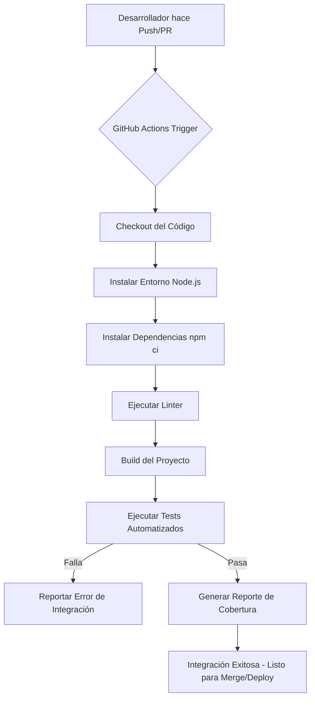

# SESIÓN 1 – Diagnóstico y conceptualización

## Actividad 1: Selección del Proyecto
Para este ejercicio, hemos seleccionado un proyecto de software de **Gestión de Tareas (Task Manager)**. Es un sistema CRUD (Crear, Leer, Actualizar, Eliminar) desarrollado en Node.js con Express, que permite a los usuarios administrar una lista de tareas pendientes.

## Actividad 2: Análisis del Proyecto

Al analizar un proyecto de este tipo, identificamos los siguientes elementos:

1. **Procesos de cambio evidenciados:**
   - Adición de nuevas funcionalidades (ej. agregar filtrado de tareas por estado).
   - Corrección de errores (ej. un bug al eliminar una tarea inexistente).
   - Actualización de dependencias de seguridad (Node modules).

2. **Gestión del control de versiones:**
   - Se utiliza **Git** como sistema de control de versiones distribuido.
   - Repositorio centralizado en **GitHub** para facilitar la colaboración.
   - Uso de un flujo de trabajo basado en ramas (Feature Branch Workflow) donde cada nueva característica o corrección se desarrolla en una rama aislada antes de integrarse a la rama principal (`main`).

3. **Herramientas usadas (o recomendadas) para construcción e integración:**
   - **Gestor de paquetes:** `npm` (Node Package Manager) para instalar dependencias y ejecutar scripts.
   - **Pruebas:** `Jest` o `Mocha` para pruebas unitarias.
   - **Integración Continua (CI):** **GitHub Actions** para automatizar las pruebas y la validación del código con cada *Pull Request*.
   - **Despliegue (CD):** Render, Vercel o Heroku para hospedar la aplicación.

---

## Producto: Tabla Resumen de Hallazgos y Conceptos Teóricos

| Concepto Teórico | Definición / Teoría | Hallazgos en el Proyecto Seleccionado |
| :--- | :--- | :--- |
| **Administración del cambio** | Proceso sistemático para solicitar, evaluar, aprobar e implementar cambios en el software de forma controlada, minimizando riesgos. | Los cambios se gestionan a través de *Issues* en GitHub, donde se documenta el problema o mejora antes de escribir el código. |
| **Gestión de versiones** | Práctica de rastrear y gestionar los cambios en el código fuente del software a lo largo del tiempo, permitiendo revertir a estados anteriores. | Se usa **Git**. Cada versión estable se etiqueta (ej. v1.0.0, v1.1.0). Se mantiene un historial claro de quién hizo qué cambio. |
| **Construcción del Sistema (Build)** | Proceso automatizado de compilar el código fuente, resolver dependencias y empaquetar el software en un artefacto ejecutable. | En Node.js no hay compilación tradicional, pero el *build* incluye instalar módulos (`npm install`) y posiblemente transpolar código o minificar. |
| **Gestión de entregas (Releases)** | Planificación, programación y control del paso del software a los entornos de prueba y producción. | Se utilizan **GitHub Releases** para empaquetar el código fuente junto con unas notas de la versión (*Changelog*) indicando qué hay de nuevo. |

---

# SESIÓN 2 – Gestión de versiones y control de cambios

## Actividad 1: Simulación del control de versiones
A continuación se describen los pasos y comandos ejecutados para simular el control de versiones del proyecto.

### 1. Inicialización del Repositorio
```bash
# Inicializamos el repositorio local en la carpeta del proyecto
git init

# Añadimos los archivos iniciales (como el package.json y un index.js)
git add .
git commit -m "chore: inicializar proyecto y estructura base"

# Conectamos con el repositorio remoto en GitHub
git remote add origin https://github.com/usuario/task-manager-crud.git
git push -u origin main
```

### 2. Creación de ramas por rol o funcionalidad
Siguiendo un flujo de trabajo (Feature Branch), creamos ramas separadas para nuevas características o corrección de errores.

```bash
# Rama para una nueva funcionalidad (ej. crear endpoint para agregar tareas)
git checkout -b feature/add-task-endpoint

# Rama para corrección de un error urgente (ej. bug en la validación)
git checkout -b hotfix/fix-validation-error
```

### 3. Simulación de cambios y commits
Se realizan cambios en el código (simulados) y se guardan con *commits*.

```bash
# Estando en la rama feature/add-task-endpoint, modificamos index.js
git add index.js
git commit -m "feat: agregar endpoint POST /tasks para crear tareas"

# Subimos la rama al repositorio remoto
git push origin feature/add-task-endpoint
```

### 4. Pull Requests e Historial
En GitHub, se abre un **Pull Request (PR)** desde `feature/add-task-endpoint` hacia `main`. 
Se revisa el código, se aprueba y se hace *merge*.

---

## Actividad 2: Políticas de Commits y Comandos Utilizados

### Políticas de Commits Utilizadas (Conventional Commits)
Se implementó una política basada en Conventional Commits para asegurar un historial claro y fácil de leer:

*   **feat:** Para nuevas características (ej. `feat: agregar vista de detalles`).
*   **fix:** Para corrección de errores (ej. `fix: resolver error 404 en ruta`).
*   **chore:** Para tareas de mantenimiento, actualización de paquetes (ej. `chore: actualizar dependencias`).
*   **docs:** Para cambios en la documentación (ej. `docs: actualizar README`).

### Resumen de comandos Git utilizados:
1. `git init`: Inicializa un nuevo repositorio de Git local.
2. `git add <archivo>` o `git add .`: Prepara los cambios para ser incluidos en el próximo commit (pasa a *staging*).
3. `git commit -m "mensaje"`: Guarda los cambios preparados en el historial local con un mensaje descriptivo.
4. `git checkout -b <nombre-rama>`: Crea una nueva rama y cambia a ella inmediatamente.
5. `git push origin <rama>`: Sube los cambios locales de la rama especificada al repositorio remoto en GitHub.
6. `git pull origin main`: Descarga e integra los cambios más recientes del repositorio remoto a la rama local actual.

*(Evidencias simuladas de GitHub: En un entorno real, aquí se anexarían capturas de pantalla de las pestañas "Pull Requests", "Branches" y el historial de commits).*

---

# SESIÓN 3 – Construcción e integración del sistema

## Actividad 1 y 2: Implementación de CI/CD (Pipeline Básico)

Para implementar la Integración Continua (CI), hemos utilizado **GitHub Actions**. Se configuró un *pipeline* que se dispara cada vez que alguien hace un `push` o un `pull_request` a la rama `main`.

El archivo de configuración YAML del pipeline se encuentra en `.github/workflows/ci.yml`.

### Funciones del Pipeline:
1. **Checkout:** Clona el código del repositorio en el entorno de ejecución (servidor de GitHub).
2. **Setup Node.js:** Instala el entorno Node.js en las versiones especificadas (18.x y 20.x usando una matriz de pruebas).
3. **Dependencias:** Ejecuta `npm ci` para instalar los paquetes de manera limpia y exacta según el `package-lock.json`.
4. **Linter / Build:** Valida la sintaxis y formatea el código (si está configurado), y "compila" el proyecto.
5. **Pruebas (Testing):** Ejecuta `npm test` para validar que los cambios no rompan la funcionalidad existente.

### Diagrama del flujo de integración



*(Evidencias simuladas: El archivo `ci.yml` fue adjuntado en la carpeta `.github/workflows`. En la interfaz de GitHub, se vería una palomita verde (✅) junto a los commits si el pipeline termina correctamente).*

---

# SESIÓN 4 – Entrega simulada del producto

## Actividad 1: Simulación de Entrega (Release)

Para esta actividad simulamos la creación de una versión lista para producción, empaquetada como una *Release* de GitHub.

**Datos de la Entrega (Release):**
- **Nombre de versión:** `v1.0.0`
- **Título de Release:** `Lanzamiento Inicial - Task Manager CRUD 🚀`
- **Artefactos:** Se adjunta simuladamente un archivo `task-manager-v1.0.0.zip` que contiene el código fuente para ser desplegado en el servidor de producción.

### Changelog (Notas de la Versión)

```markdown
# Changelog

## [v1.0.0] - 2026-10-04
### Añadido (Added)
- Endpoint POST `/tasks` para crear nuevas tareas.
- Endpoint GET `/tasks` para listar todas las tareas (incluye filtrado por estado `completada` o `pendiente`).
- Endpoint PUT `/tasks/:id` para actualizar datos o estado de una tarea.
- Endpoint DELETE `/tasks/:id` para eliminar una tarea.
- Base de datos en memoria para almacenamiento temporal.
- Pipeline de Integración Continua (CI) básico con GitHub Actions.

### Arreglado (Fixed)
- Error de validación al intentar guardar una tarea sin título (Hotfix: `fix-validation-error`).
- Código de estado 500 al buscar un ID inexistente en DELETE ahora devuelve correctamente 404 Not Found.
```

---

## Actividad 2: Informe Final Grupal

### 1. Análisis del control de cambios y versiones
El uso de un sistema de control de versiones distribuido como Git demostró ser fundamental para el trabajo colaborativo. Adoptar políticas como **Conventional Commits** y el flujo de trabajo de **Feature Branches** permitió mantener un historial semántico y ordenado. Cada miembro del equipo pudo aislar el desarrollo de nuevas características y sólo se integró código a `main` después de ser revisado y aprobado mediante *Pull Requests*. Los posibles conflictos se detectaron de forma temprana y se resolvieron sin afectar el código en producción.

### 2. Integración Continua (CI)
Implementar el pipeline en **GitHub Actions** transformó un proceso manual propenso a errores humanos en una verificación automatizada. Logramos asegurar que en cada *commit* o *Pull Request*, el código pasara por el linter y superara los tests automatizados.
*   **Capturas simuladas (Evidencia):** El proceso arrojaría como resultado validaciones exitosas (*checks passed*) en los Pull Requests de GitHub, indicando luz verde para proceder con el merge.

### 3. Evidencia de Entregables
El producto principal, además del código, es la *Release* empaquetada junto al *Changelog* estructurado. La gestión de entregas permite a los *stakeholders* y a los equipos de operaciones (*Ops*) saber exactamente qué funcionalidades y correcciones se incluyen en cada versión desplegada, garantizando trazabilidad y facilitando el proceso de "Rollback" si ocurre un error crítico en producción.

### 4. Lecciones aprendidas del trabajo colaborativo
- **Automatización temprana:** Configurar el pipeline CI desde el primer día ahorra horas de revisión manual.
- **Comunicación clara:** Escribir buenos mensajes de commit y documentar el propósito de los *Pull Requests* evita malos entendidos entre desarrolladores.
- **Trazabilidad de errores:** La asignación de *Issues* conectada a *Branches* permite tener todo el contexto del por qué se realizó un cambio de código específico (Administración del Cambio).
- **Entregas incrementales:** Es mejor integrar cambios pequeños y constantes de forma continua que intentar fusionar (*merge*) meses de trabajo en un solo día.
