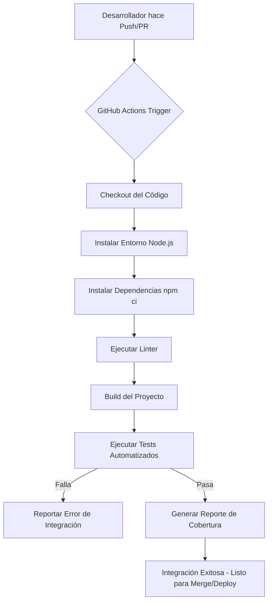

# SESIÓN 3 – Construcción e integración del sistema

## Actividad 1 y 2: Implementación de CI/CD (Pipeline Básico)

Para implementar la Integración Continua (CI), hemos utilizado **GitHub Actions**. Se configuró un *pipeline* que se dispara cada vez que alguien hace un `push` o un `pull_request` a la rama `main`.

El archivo de configuración YAML del pipeline se encuentra en `.github/workflows/ci.yml`.

### Funciones del Pipeline:
1. **Checkout:** Clona el código del repositorio en el entorno de ejecución (servidor de GitHub).
2. **Setup Node.js:** Instala el entorno Node.js en las versiones especificadas (18.x y 20.x usando una matriz de pruebas).
3. **Dependencias:** Ejecuta `npm ci` para instalar los paquetes de manera limpia y exacta según el `package-lock.json`.
4. **Linter / Build:** Valida la sintaxis y formatea el código (si está configurado), y "compila" el proyecto.
5. **Pruebas (Testing):** Ejecuta `npm test` para validar que los cambios no rompan la funcionalidad existente.

### Diagrama del flujo de integración

*(Evidencias simuladas: El archivo `ci.yml` fue adjuntado en la carpeta `.github/workflows`. En la interfaz de GitHub, se vería una palomita verde (✅) junto a los commits si el pipeline termina correctamente).*
